<picture>
  <source media="(prefers-color-scheme: dark)" srcset="https://raw.githubusercontent.com/CaioRenatoDot/CaioRenatoDot/main/assets/banner-dark.svg">
  
</picture>

## Oi, eu sou o Caio

Sou desenvolvedor full stack e gosto mesmo é de levar uma ideia do zero até o deploy: modelar o banco, escrever a API, construir a interface e colocar no ar. Boa parte do que está aqui nasceu de projetos de faculdade que eu resolvi levar mais a sério do que o enunciado pedia.

Hoje estou aprofundando **TypeScript**, **Next.js** e arquitetura de APIs.

## O que eu ando construindo

### [Watchd](https://github.com/CaioRenatoDot/ProjetoIntegradorMorrissey2)

Um "Letterboxd para séries": watchlist, reviews com nota de meia em meia estrela, favoritos e listas temáticas, tudo exposto em um perfil público. A API é feita do zero — autenticação com JWT em cookie `httpOnly`, senhas com bcrypt, rate limiting e seis entidades no Prisma ligadas ao usuário com `onDelete: Cascade`. Os dados das séries vêm da TVMaze; no banco fica só o que é do usuário.

`React` · `Vite` · `Tailwind` · `Express` · `Prisma` · `PostgreSQL`

### [VoiceMatchAi](https://github.com/CaioRenatoDot/VoiceMatchAi)

Aplicação de voz com IA: front em Next.js 16 com React 19 e shadcn/ui, back em FastAPI integrando OpenAI e ElevenLabs, com storage no Supabase e testes em pytest. Projeto em equipe, com padrão definido de branch, commit e PR.

`Next.js` · `TypeScript` · `shadcn/ui` · `FastAPI` · `Supabase`

## Stack

| Camada | O que uso |
| :--- | :--- |
| **Front-end** | React · Next.js · TypeScript · Tailwind CSS · Vite |
| **Back-end** | Node.js · Express · Python · FastAPI |
| **Dados** | PostgreSQL · Prisma · Supabase |
| **Ferramentas** | Git · Vitest · pytest · Vercel · Linux |

## Onde me achar

[Portfólio](https://caiorenatodot.vercel.app) &nbsp;·&nbsp; [LinkedIn](https://www.linkedin.com/in/caiorenato) &nbsp;·&nbsp; [caiorenato146@gmail.com](mailto:caiorenato146@gmail.com)
